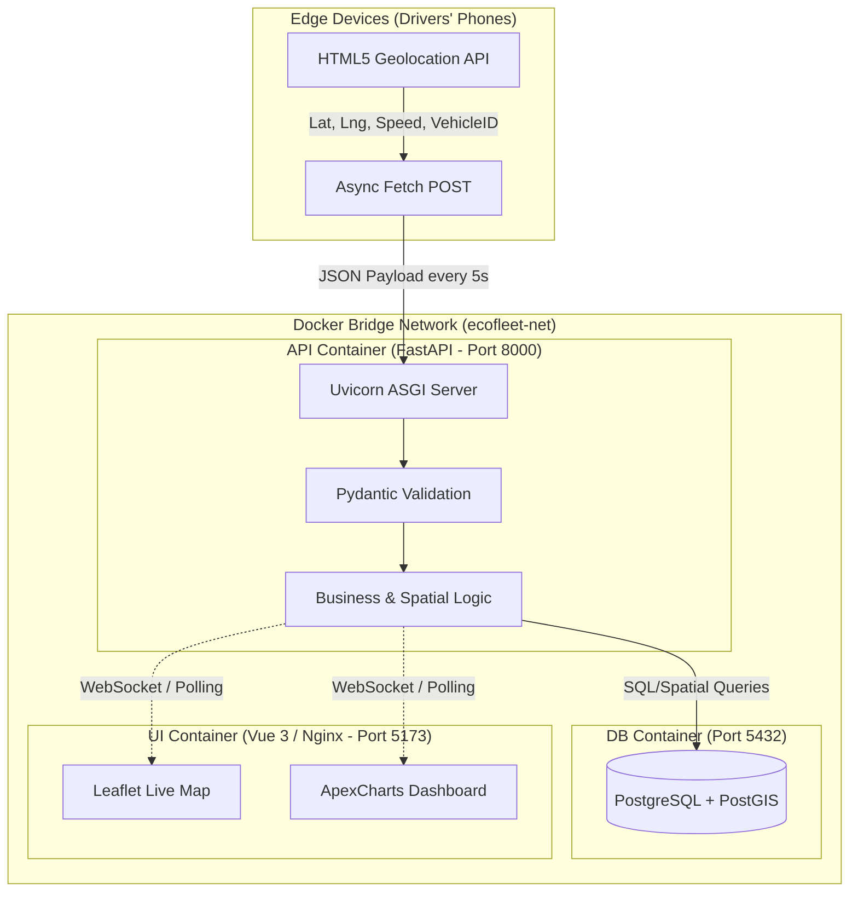

# EcoFleet-Core: Enterprise IoT Fleet Management & Telemetry Engine


An enterprise-grade, eco-conscious fleet management and real-time vehicle tracking architecture. Engineered to monitor live geolocation telemetry, prevent idle fuel consumption, and optimize field operations via high-performance spatial data processing.

Transitioning from traditional hardware-dependent GPS trackers to a **Bring Your Own Device (BYOD)** model, EcoFleet-Core utilizes drivers' existing mobile devices to stream asynchronous telemetry coordinates directly into a volatile memory pipeline, which is then processed and rendered on a cyberpunk-themed Vue 3 dashboard.

---

## 🛠️ Tech Stack & Packages Used

### Backend & Telemetry API (Python)
* **FastAPI**: High-performance asynchronous RESTful framework for IoT data ingestion.
* **Uvicorn**: Lightning-fast ASGI server.
* **SQLAlchemy & GeoAlchemy2**: ORM and spatial data mapping.
* **Pydantic**: Strict data validation and settings management.

### Frontend & Dashboard (Vue 3)
* **Vue 3 (Composition API)**: Core frontend framework.
* **Vite**: Next-generation frontend tooling and bundler.
* **Leaflet.js**: High-performance interactive mapping and routing.
* **ApexCharts (vue3-apexcharts)**: Interactive and responsive eco-metrics visualization.

### Database & DevOps
* **PostgreSQL + PostGIS**: Advanced open-source relational database extended for geographic objects.
* **Docker & Docker Compose**: Multi-container orchestration (`db`, `api`, `ui`).

---

## 📂 Enterprise Directory Structure

Below is the layout of the solution, exhibiting a clean Separation of Concerns (SoC) across the full-stack environment:

```text
📂 EcoFleet-Core/
│
├── 🐳 docker-compose.yml            # Multi-container orchestration (PostgreSQL, FastAPI, Nginx)
│
├── 📂 EcoFleet.API/                 # Python FastAPI Backend Layer
│   ├── 🐳 Dockerfile                
│   ├── main.py                      # ASGI Application Bootstrapper & Middleware
│   ├── 📂 api/                      # REST Endpoints (Track, Vehicles, WorkOrders)
│   ├── 📂 core/                     # Business Logic & Telemetry Processing
│   └── 📂 models/                   # SQLAlchemy & Pydantic Data Schemas
│
├── 📂 EcoFleet.UI/                  # Enterprise Vue 3 Frontend (Vite)[cite: 4]
│   ├── 🐳 Dockerfile                # Node.js Build -> Nginx Alpine Serve[cite: 4]
│   ├── 📂 src/
│   │   ├── App.vue                  # Main Dashboard & Live Map UI
│   │   ├── 📂 components/           # Map, WorkOrderModal, FleetList
│   │   └── main.js                  # Vue Application Initialization
│   └── vite.config.js               # Vite Proxy Configuration[cite: 4]
│
├── 📂 EcoFleet.Client/              # Mobile PWA for Drivers
│   └── index.html                   # HTML5 Geolocation API Transmitter
│
└── 📂 EcoFleet.DB/                  # Database Assets
    └── init_postgis.sql             # SQL Script for table & spatial initialization
```

## 🏗️ System Architecture & Real-Time Data Flow

To maintain a production-grade ecosystem, EcoFleet-Core implements strict modularity.



## 🗺️ Development Roadmap

    [ ] v1.0.0 - Core telemetry ingestion pipeline and basic Leaflet live mapping.

    [ ] v1.5.0 - PostgreSQL + PostGIS integration for persistent spatial history.

    [ ] v2.0.0 - Work Order generation and dynamic dispatching system.

    [ ] v2.5.0 - Eco-Metrics AI (Idle detection, route deviation analytics).

    [ ] v3.0.0 - Complete Full-Stack Dockerization (Nginx, Python 3.11, PostgreSQL).

## 📄 License & Architecture

This architecture is completely open-source and released under the MIT License. Designed and engineered for high-performance enterprise fleet telemetry analysis.
