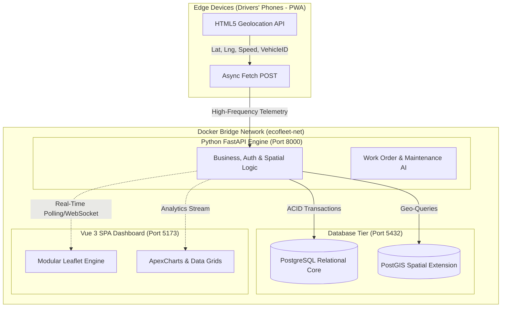

# EcoFleet-Core: Enterprise Fleet Intelligence & IoT Telemetry Engine


EcoFleet-Core is an enterprise-grade, eco-conscious B2B fleet management and real-time vehicle tracking architecture developed for Muğla Water and Sewerage Administration (MUSKİ). Engineered to monitor live geolocation telemetry, prevent idle fuel consumption, track daily mileage, and optimize field operations via high-performance spatial data processing.

Transitioning from traditional hardware-dependent GPS trackers to a **Bring Your Own Device (BYOD)** Progressive Web App (PWA) model, EcoFleet-Core utilizes drivers' existing mobile devices to stream asynchronous telemetry coordinates. The ecosystem is designed with modular **Patch-Ready Architecture**, allowing dynamic loading of map modules and spatial analytics.

---

## 🏗️ Enterprise System Architecture



## 🚀 Core Features & Modules

*   Real-Time Telemetry & Tracking: Live tracking without initial heavy map loads; maps are integrated as modular, future-proof patches.
*   Enterprise Relational Grid: Advanced tracking of Daily Starting/Ending Mileage, personnel titles (Driver, Manager, Admin).
*   Maintenance & Incident Tracking: Dedicated logs for accident reports, replaced parts, damage costs, and automated alerts for approaching vehicle inspection (Vize) dates.
*   Work Order Generation: Dynamic dispatching and field task assignment pipeline.
*   Role-Based Access Control (RBAC): Tiered administrative intervention rights for fleet managers.

## 📂 Quick Start

*    Clone the repository: ```git clone https://github.com/EgeSu/EcoFleet-Core.git```
*    Install API dependencies: ```pip install fastapi uvicorn pydantic loguru```
*    Boot the backend engine: ```uvicorn main:app --reload```
*    Install UI dependencies: ```cd EcoFleet.UI && npm install```
*    Boot the Vue 3 Dashboard: ``` npm run dev```

##  🗺️ Development Roadmap

*    [ ] v1.0.0 - PostgreSQL + PostGIS integration for persistent spatial history.
*    [ ] v2.0.0 - Work Order generation and dynamic dispatching system.
*    [ ] v2.5.0 - Eco-Metrics AI (Idle detection, route deviation analytics).
*    [ ] v3.0.0 - Complete Full-Stack Dockerization (Nginx, Python 3.11, PostgreSQL).
*    [ ] v3.5.0   (optional) - Core telemetry ingestion pipeline and basic Leaflet live mapping.

##  📄 License & Architecture

This architecture is completely open-source and released under the MIT License. Designed and engineered for high-performance enterprise fleet telemetry analysis[cite: 4, 5].
