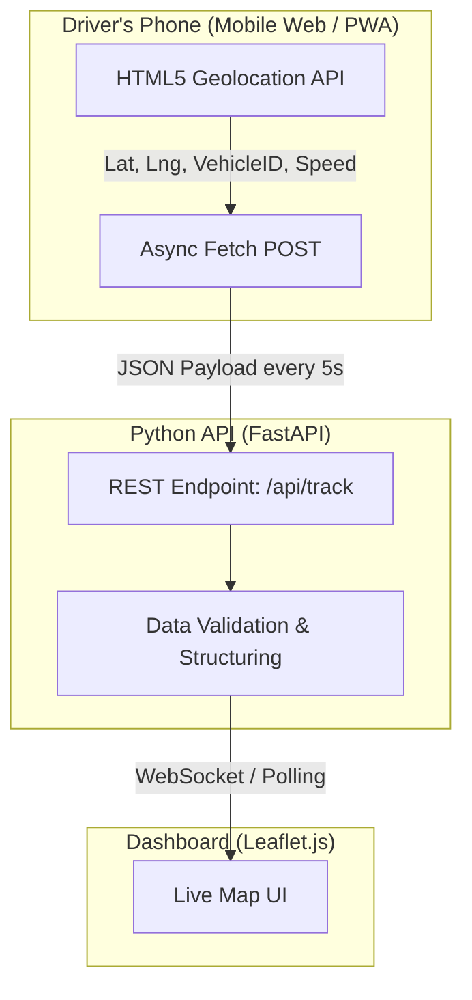

# EcoFleet-Core: Environmental Vehicle Tracking & Fleet Management


An eco-conscious fleet management and live vehicle tracking architecture developed for Muğla Water and Sewerage Administration (MUSKİ). Engineered to monitor real-time geolocation data, prevent idle fuel consumption, and optimize field operations to reduce the institutional carbon footprint.

---

## 🏗️ System Architecture & Real-Time Data Flow


## 🚀 3-Day MVP Features

 * Real-Time Geolocation Tracking: Streams live GPS coordinates from the driver's smartphone directly to the backend.
 * Eco-Metrics & Idle Detection: Baseline architecture designed to monitor unnecessary engine idling and route deviations.
 * Work Order Integration Ready: Modular data structure prepared for upcoming task assignment features.
 * Hardware-Free: Relies entirely on the drivers' existing mobile devices without requiring costly OBD2 GPS trackers.

## 📂 Quick Start

 * Clone the repository: ``` git clone https://github.com/YourUsername/EcoFleet-Core.git ```

 * Install dependencies: ``` pip install fastapi uvicorn pydantic ```

 * Boot the backend engine: ``` uvicorn main:app --reload ```
